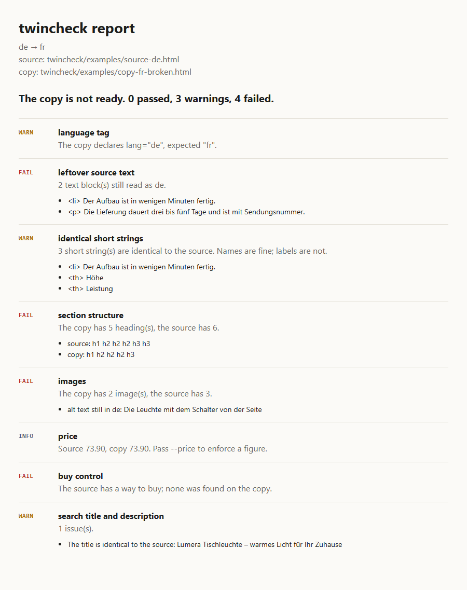

# twincheck

Check a translated copy of a web page against its source, before a customer finds the mistake.

When a product page is duplicated into another language, the same few things go wrong: a paragraph is left in the old language, a section goes missing, the old price stays, the buy button does not come across. `twincheck` reads both pages and reports each of those in one run. It exits with code 1 when the copy is not ready, so it also works in CI.

It is plain Python with no dependencies and no AI model. It reads the HTML it is given.

## Try it

```bash
pip install git+https://github.com/MicoleKurt/twincheck
```

```bash
twincheck demo
```

The demo compares a German example page with a French copy that has every common mistake:

```
twincheck  de -> fr

[WARN] language tag                   The copy declares lang="de", expected "fr".
[FAIL] leftover source text           2 text block(s) still read as de.
         - <li> Der Aufbau ist in wenigen Minuten fertig.
         - <p> Die Lieferung dauert drei bis fünf Tage und ist mit Sendungsnummer.
[WARN] identical short strings        3 short string(s) are identical to the source. Names are fine; labels are not.
[FAIL] section structure              The copy has 5 heading(s), the source has 6.
[FAIL] images                         The copy has 2 image(s), the source has 3.
         - alt text still in de: Die Leuchte mit dem Schalter von der Seite
[FAIL] price                          The copy shows 73.90, expected 68.90.
[FAIL] buy control                    The source has a way to buy; none was found on the copy.
[WARN] search title and description   1 issue(s).

0 passed, 3 warnings, 5 failed. The copy is not ready.
```

`twincheck demo --good` runs the same checks on a clean copy.

With `--html report.html` the same result is written as a one-file report:



## Use it on your pages

```bash
twincheck compare https://shop.example/products/lamp https://shop.example/fr/products/lampe --lang fr --price 68.90 --ignore "Lumera" --html report.html
```

| Option | What it does |
|---|---|
| `SOURCE`, `COPY` | A URL or a saved HTML file for each page. |
| `--lang` | The language the copy should be in. Required. |
| `--price` | The price the copy must show. Without it, both prices are only reported. |
| `--ignore` | Text to skip, such as a brand name. Repeatable. |
| `--source-lang` | The source language, when the guess is wrong. |
| `--html FILE` | Also write a one-file HTML report. |
| `--json` | Print the result as JSON. |

Languages: `de`, `en`, `es`, `fi`, `fr`, `it`, `nl`, `sv`.

## What it checks

| Check | Fails when | Warns when |
|---|---|---|
| Leftover source text | A text block still reads as the source language. | |
| Identical short strings | | A short label is copied letter for letter. |
| Section structure | The copy has fewer headings than the source. | The order or the levels differ, or the copy has more. |
| Images | The copy has fewer images. | Alt text is missing or still in the source language. |
| Price | `--price` is given and the copy shows another figure, or none. | No price is found. |
| Buy control | The source has a cart form, cart link or buy button and the copy has none. | |
| Language tag | | `<html lang>` is missing or wrong. |
| Search title and description | | Either is missing or identical to the source. |

## Limits

- **It reads HTML as delivered.** Text, prices or buttons that a script adds after the page loads are not seen. Save the rendered page from the browser and pass the file when a page is built that way.
- **Language is guessed from common words.** A block needs at least two of them, so very short text is not judged. Closely related languages can be confused in short sentences.
- **Words inside images are not read.**
- **It does not judge translation quality.** It finds text that was not translated, not text that was translated badly.
- **Some shops block automated requests.** Use saved HTML files when a URL returns an error.

## Development

```bash
python -m unittest discover -s tests
```

15 tests, standard library only. Python 3.9 or later.

## Why I made it

I duplicate Shopify product pages into other languages for an e-commerce brand group. The checks here are the ones I ran by hand after every page. This is the general version, rebuilt on invented example pages; it contains no client code, names or data.

MIT licence.
